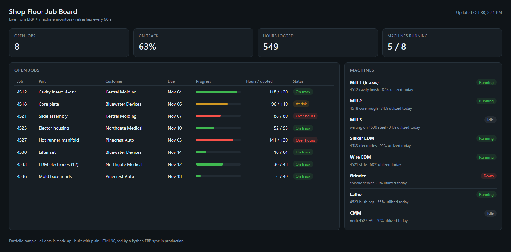

# Shop Floor Job Board

A portfolio sample of a live job board for a machine shop: open jobs, hours against quote, due dates and
machine status on one screen. **All data here is made up.**

## About the real one

I built and run the production version at a precision mold shop. There it refreshes every 60 seconds
from the ERP and the machine monitors, runs on Node.js in Docker on the shop's own server, and costs
nothing to license. I presented it at AMBA (American Mold Builders Association) 2026.

This sample is plain HTML and JavaScript with no build step. Open `index.html` in a browser to see it.
